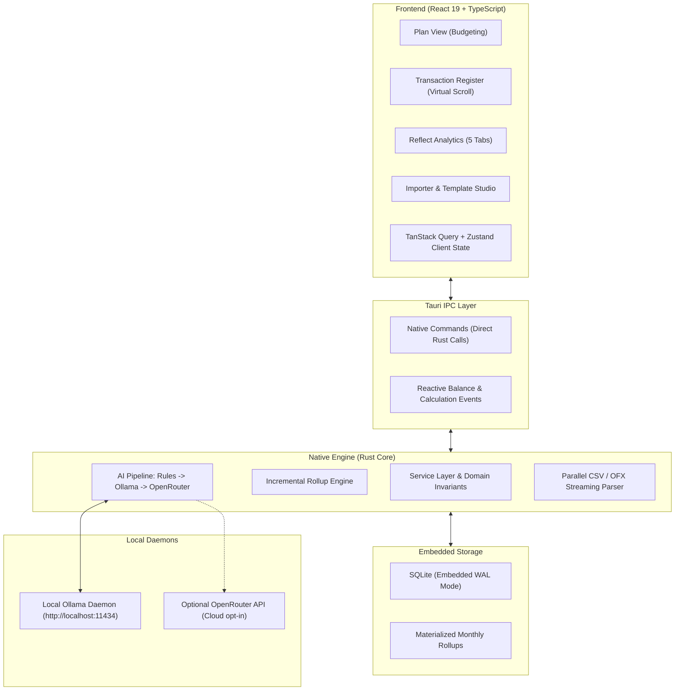
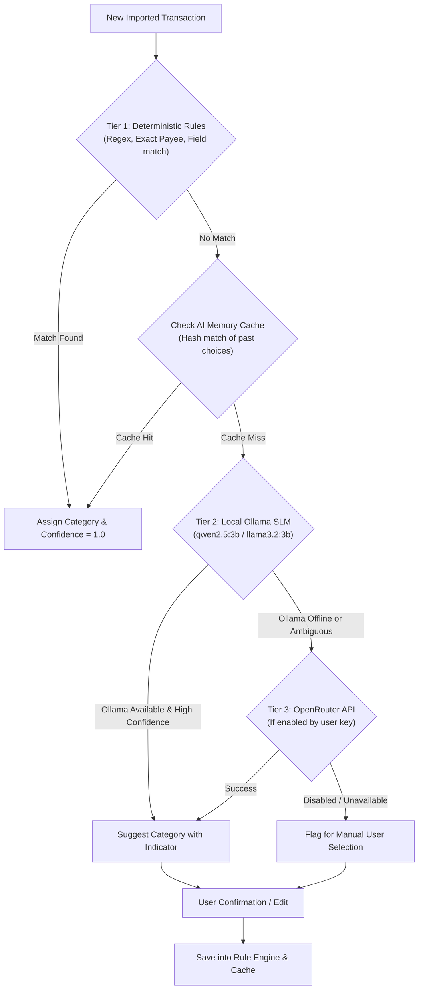

# metacent — System Architecture Specification

## Overview

**metacent** is a high-performance, privacy-first desktop budgeting application built with **Tauri 2.0 (Rust)** and a **React 19 / TypeScript** frontend. It is designed to run locally with zero cloud dependencies, deliver native multi-platform builds (Linux Mint, Windows, macOS), and effortlessly handle historical databases containing **millions of transactions**.

---

## Architectural Topology



---

## 1. High-Performance Calculation Engine (Handling Millions of Transactions)

### The Challenge of Large Historical Data
When a user possesses 10+ years of categorized data (1,000,000+ transactions), executing on-the-fly SQL queries like:
```sql
SELECT category_id, SUM(amount_cents) FROM transactions WHERE date BETWEEN ? AND ? GROUP BY category_id;
```
during rapid typing or navigation causes UI micro-stutters and battery drain.

### The Solution: Materialized Monthly Rollups with Incremental Deltas

1. **Precomputed State**:
   - `monthly_category_rollups` stores the aggregated `activity_cents` and `assigned_cents` for each `(budget_id, month, category_id)` tuple.
   - `monthly_account_rollups` stores monthly cleared and uncleared flow totals.

2. **$O(1)$ Incremental Delta Updates**:
   - When a transaction is created, updated, or deleted, metacent does **not** re-sum millions of rows.
   - Instead, it applies a delta directly to the target month's rollup:
     $$\Delta_{\text{activity}} = \text{new\_amount} - \text{old\_amount}$$
     $$\text{activity\_cents}_{\text{month}} \leftarrow \text{activity\_cents}_{\text{month}} + \Delta_{\text{activity}}$$
   - If a transaction's date is changed from one month to another, deltas are cleanly applied to both respective monthly rollup records.

3. **Cumulative Available Balance Propagation**:
   - The available balance of a category in month $M$ depends on the rollover from month $M-1$.
   - When a historical transaction (e.g., from 3 years ago) is modified, the delta only cascades across the **monthly summary rows** (at most 120 rows for 10 years), taking less than $0.05\text{ms}$ in Rust.

4. **Instant View Queries**:
   - Opening any month's budget view performs a single `SELECT * FROM monthly_category_rollups WHERE budget_id = ? AND month = ?`. For 50 categories, this returns 50 rows in $< 0.2\text{ms}$.

---

## 2. AI Categorization Pipeline

Transactions imported from statements often have cryptic payees (e.g., `PAYPAL *AMZN MKTPLACE`, `SUMUP *BAECKEREI 2341`). metacent employs a 3-tier cascade:



### Tier 1: Deterministic Rule Engine (Sub-millisecond)
- Evaluates exact payee matches, regex patterns, and account-specific field rules (e.g., column `Typ == 'Dauerauftrag'`).
- Handles 80–90% of routine transactions with 0% error rate.

### Tier 2: Local Small Language Models (Ollama)
- Communicates with local Ollama (`localhost:11434`).
- Prompts small, fast models (`qwen2.5:1.5b/3b`, `llama3.2:3b`, `phi3.5`) with a structured schema and the user's active category list.
- Runs 100% locally and offline without transmitting financial data over the internet.

### Tier 3: Optional Decision / Cloud Model (OpenRouter)
- Optional user-configured fallback for maximum intelligence when local compute is constrained.
- Requires explicit user API key input.

### The Feedback Learning Loop
- When a user confirms or corrects a suggestion, metacent writes the decision into `categorization_rules` and `ai_categorization_cache`, making subsequent imports faster and smarter.

---

## 3. Account-Specific Importer Template System

Different institutions export different CSV formats:
- **Trade Republic**: Semicolon-delimited, German date `DD.MM.YYYY`, separate columns for `Typ`, `Betrag`, `Notiz`.
- **Commerzbank / DKB**: Comma or semicolon, German decimal commas (`1.234,56`), separate booking/valuta dates.

### Architecture:
- Each account can have one or more linked **`ImportProfile`** configurations.
- During CSV upload, metacent tests the file headers against saved profiles for that account.
- If a match is detected, the preview auto-maps columns immediately.
- Custom field rules in the profile can route transactions based on statement metadata (e.g., if column `Buchungstext` contains "KARTENZAHLUNG" $\to$ category "Einkauf").

---

## 4. UI Virtualization & DOM Optimization

Even though the database can query millions of rows in milliseconds, the browser DOM cannot hold 100,000 table rows without crashing.
- The transaction register uses **TanStack Virtual**.
- Only the rows visible in the viewport (+ an overscan of 5 rows above and below, ~35 rows total) are mounted as DOM elements.
- Absolute positioning translates each row based on virtual scroll offset.
- Scrolling through millions of historical transactions remains locked at 60 frames per second.
