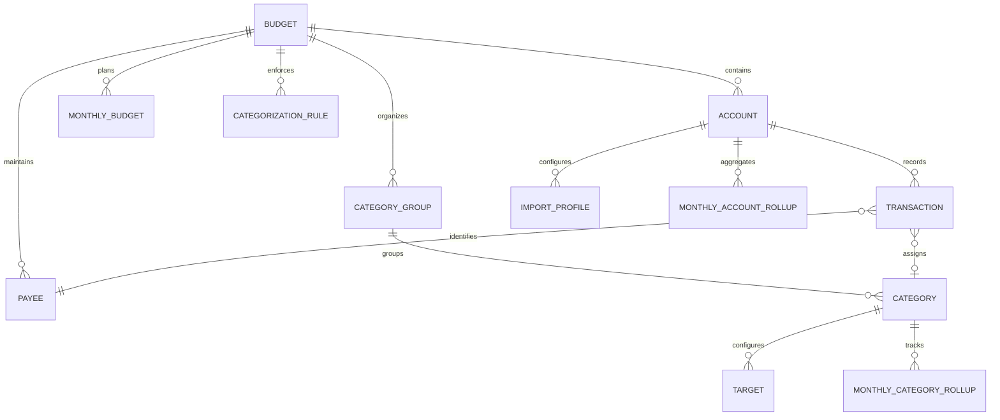

# metacent — Data Model & Schema Specification

## Overview

The **metacent** data model is optimized for:
1. **Zero-Based Budgeting Integrity**: Maintaining the invariant `Total Cash = Ready to Assign + Sum(All Category Available)`.
2. **Extreme Scalability**: Capable of handling millions of historical transactions with sub-millisecond query response times via materialized monthly rollups.
3. **Local Privacy**: Purely local SQLite schema with no third-party bank linking dependencies.
4. **Intelligent Categorization**: Account-specific importer templates, deterministic rule definitions, and local AI categorization history.

---

## Entity-Relationship Diagram



---

## Core Schema Definitions (SQLite / Rust)

### 1. `budgets`
The root container for a personal financial domain.

| Column | SQLite Type | Rust Type | Description |
| :--- | :--- | :--- | :--- |
| `id` | `TEXT PRIMARY KEY` | `String / Uuid` | UUID v4 |
| `name` | `TEXT NOT NULL` | `String` | Budget name (e.g. "Hauptbudget") |
| `currency` | `TEXT NOT NULL DEFAULT 'EUR'` | `String` | ISO 4217 code (`EUR`) |
| `currency_symbol`| `TEXT NOT NULL DEFAULT '€'` | `String` | Symbol (`€`) |
| `date_format` | `TEXT NOT NULL DEFAULT 'DD.MM.YYYY'`| `String` | Display format |
| `language` | `TEXT NOT NULL DEFAULT 'de-DE'`| `String` | Locale code |
| `created_at` | `INTEGER NOT NULL` | `i64` | Unix timestamp (ms) |
| `updated_at` | `INTEGER NOT NULL` | `i64` | Unix timestamp (ms) |

---

### 2. `accounts`
Financial accounts holding assets or debts. All bank connection fields are omitted.

| Column | SQLite Type | Rust Type | Description |
| :--- | :--- | :--- | :--- |
| `id` | `TEXT PRIMARY KEY` | `String / Uuid` | UUID v4 |
| `budget_id` | `TEXT NOT NULL REFERENCES budgets(id)` | `String` | Foreign key |
| `nickname` | `TEXT NOT NULL` | `String` | e.g. "DKB Girokonto", "Trade Republic" |
| `account_type` | `TEXT NOT NULL` | `AccountType` | Enum: `checking`, `savings`, `cash`, `credit_card`, `line_of_credit`, `mortgage`, `loan` |
| `is_favorite` | `INTEGER NOT NULL DEFAULT 0` | `bool` | Star toggle |
| `is_closed` | `INTEGER NOT NULL DEFAULT 0` | `bool` | Archived state |
| `notes` | `TEXT DEFAULT ''` | `String` | Account notes |
| `sort_order` | `INTEGER NOT NULL DEFAULT 0` | `i32` | Custom sidebar sorting |
| `last_reconciled_at` | `INTEGER` | `Option<i64>` | Timestamp of last reconciliation |

---

### 3. `category_groups` & `categories`
Hierarchical budget buckets. **Note: No emojis or colored icons.**

#### `category_groups`
| Column | SQLite Type | Rust Type | Description |
| :--- | :--- | :--- | :--- |
| `id` | `TEXT PRIMARY KEY` | `String` | UUID v4 |
| `budget_id` | `TEXT NOT NULL REFERENCES budgets(id)` | `String` | Foreign key |
| `name` | `TEXT NOT NULL` | `String` | e.g. "Rechnungen & Fixkosten", "Bedarfe", "Wünsche" |
| `is_collapsed` | `INTEGER NOT NULL DEFAULT 0` | `bool` | UI collapse state |
| `sort_order` | `INTEGER NOT NULL DEFAULT 0` | `i32` | Order within budget |

#### `categories`
| Column | SQLite Type | Rust Type | Description |
| :--- | :--- | :--- | :--- |
| `id` | `TEXT PRIMARY KEY` | `String` | UUID v4 |
| `group_id` | `TEXT NOT NULL REFERENCES category_groups(id)` | `String` | Parent group |
| `name` | `TEXT NOT NULL` | `String` | e.g. "Miete", "Lebensmittel", "Strom", "ÖPNV" |
| `notes` | `TEXT DEFAULT ''` | `String` | Category description and notes |
| `is_hidden` | `INTEGER NOT NULL DEFAULT 0` | `bool` | Soft hide |
| `sort_order` | `INTEGER NOT NULL DEFAULT 0` | `i32` | Order within group |

---

### 4. `targets` (Category Goals)
Rules for funding categories.

| Column | SQLite Type | Rust Type | Description |
| :--- | :--- | :--- | :--- |
| `id` | `TEXT PRIMARY KEY` | `String` | UUID v4 |
| `category_id` | `TEXT NOT NULL UNIQUE REFERENCES categories(id)` | `String` | 1-to-1 per category |
| `target_type` | `TEXT NOT NULL` | `TargetType` | Enum: `weekly`, `monthly`, `yearly`, `custom` |
| `amount_cents` | `INTEGER NOT NULL` | `i64` | Target amount in minor units (cents) |
| `due_date` | `TEXT` | `Option<String>` | ISO date `YYYY-MM-DD` |
| `rollover_action` | `TEXT NOT NULL DEFAULT 'set_aside'` | `String` | e.g. "set_aside_another" |

---

### 5. `transactions`
The central ledger storing financial activity.

| Column | SQLite Type | Rust Type | Description |
| :--- | :--- | :--- | :--- |
| `id` | `TEXT PRIMARY KEY` | `String` | UUID v4 |
| `account_id` | `TEXT NOT NULL REFERENCES accounts(id)` | `String` | Foreign key |
| `date` | `TEXT NOT NULL` | `String` | ISO date `YYYY-MM-DD` (Indexed) |
| `payee_id` | `TEXT REFERENCES payees(id)` | `Option<String>` | Foreign key |
| `category_id` | `TEXT REFERENCES categories(id)` | `Option<String>` | NULL for transfers or split parent |
| `memo` | `TEXT DEFAULT ''` | `String` | Free text |
| `amount_cents` | `INTEGER NOT NULL` | `i64` | Signed integer cents (+ inflow, - outflow) |
| `cleared_status` | `TEXT NOT NULL DEFAULT 'uncleared'` | `ClearedStatus` | Enum: `uncleared`, `cleared`, `reconciled` |
| `is_approved` | `INTEGER NOT NULL DEFAULT 1` | `bool` | Needs approval after import |
| `flag` | `INTEGER NOT NULL DEFAULT 0` | `u8` | Neutral flag code `0`–`6` |
| `transfer_account_id`| `TEXT REFERENCES accounts(id)` | `Option<String>` | Linked account for transfers |
| `transfer_transaction_id`| `TEXT REFERENCES transactions(id)`| `Option<String>` | Paired transfer row |
| `import_fitid` | `TEXT` | `Option<String>` | Bank transaction ID for deduplication |
| `created_at` | `INTEGER NOT NULL` | `i64` | Timestamp |
| `updated_at` | `INTEGER NOT NULL` | `i64` | Timestamp |

**Indexes on `transactions`:**
```sql
CREATE INDEX idx_tx_account_date ON transactions(account_id, date DESC);
CREATE INDEX idx_tx_category_date ON transactions(category_id, date);
CREATE INDEX idx_tx_date ON transactions(date);
CREATE INDEX idx_tx_import_fitid ON transactions(import_fitid);
```

---

## Architectural Scalability: Materialized Rollup Tables

To guarantee that calculations remain instant across **millions of transactions**, metacent uses precomputed monthly rollup tables.

### 6. `monthly_category_rollups`
Tracks exact monthly assigned and activity amounts per category without table scans.

| Column | SQLite Type | Rust Type | Description |
| :--- | :--- | :--- | :--- |
| `budget_id` | `TEXT NOT NULL REFERENCES budgets(id)` | `String` | Foreign key |
| `month` | `TEXT NOT NULL` | `String` | Format: `YYYY-MM` (e.g. `2026-11`) |
| `category_id` | `TEXT NOT NULL REFERENCES categories(id)` | `String` | Category foreign key |
| `assigned_cents` | `INTEGER NOT NULL DEFAULT 0` | `i64` | Amount budgeted this month |
| `activity_cents` | `INTEGER NOT NULL DEFAULT 0` | `i64` | Sum of all outflows/inflows this month |
| `note` | `TEXT DEFAULT ''` | `String` | Category month note |

**Composite Primary Key:** `PRIMARY KEY (budget_id, month, category_id)`

#### Available Balance Invariant:
$$\text{Available}_{\text{month}} = \max(0, \text{Available}_{\text{month}-1}) + \text{Assigned}_{\text{month}} + \text{Activity}_{\text{month}}$$
*(Note: Rolling negative category balances can optionally carry over or be absorbed by Ready to Assign according to user preference).*

---

### 7. `monthly_account_rollups`
Maintains monthly cash flows and balance anchors per account.

| Column | SQLite Type | Rust Type | Description |
| :--- | :--- | :--- | :--- |
| `account_id` | `TEXT NOT NULL REFERENCES accounts(id)` | `String` | Foreign key |
| `month` | `TEXT NOT NULL` | `String` | Format: `YYYY-MM` |
| `cleared_inflows_cents` | `INTEGER NOT NULL DEFAULT 0` | `i64` | Sum of cleared deposits |
| `cleared_outflows_cents`| `INTEGER NOT NULL DEFAULT 0` | `i64` | Sum of cleared spending |
| `uncleared_inflows_cents`| `INTEGER NOT NULL DEFAULT 0`| `i64` | Sum of uncleared deposits |
| `uncleared_outflows_cents`| `INTEGER NOT NULL DEFAULT 0`| `i64` | Sum of uncleared spending |

**Composite Primary Key:** `PRIMARY KEY (account_id, month)`

---

## Importer & AI Categorization Tables

### 8. `import_profiles`
Stores reusable CSV/statement mapping templates per account (e.g. Trade Republic, Commerzbank).

| Column | SQLite Type | Rust Type | Description |
| :--- | :--- | :--- | :--- |
| `id` | `TEXT PRIMARY KEY` | `String` | UUID v4 |
| `account_id` | `TEXT NOT NULL REFERENCES accounts(id)` | `String` | Account association |
| `profile_name` | `TEXT NOT NULL` | `String` | e.g. "Trade Republic CSV Export" |
| `delimiter` | `TEXT NOT NULL DEFAULT ';'` | `String` | CSV delimiter (`,`, `;`, `\t`) |
| `date_format` | `TEXT NOT NULL DEFAULT 'DD.MM.YYYY'`| `String` | Source date format |
| `decimal_separator`| `TEXT NOT NULL DEFAULT ','` | `String` | `,` or `.` |
| `thousands_separator`| `TEXT NOT NULL DEFAULT '.'` | `String` | `.` or `,` |
| `header_row_index` | `INTEGER NOT NULL DEFAULT 0` | `i32` | Line number of header |
| `field_mappings` | `TEXT NOT NULL` | `String (JSON)` | Column map: `{ "date": "Buchungstag", "payee": "Zahlungsempfänger", "amount": "Betrag", ... }` |
| `created_at` | `INTEGER NOT NULL` | `i64` | Timestamp |

---

### 9. `categorization_rules` & `ai_categorization_cache`

#### `categorization_rules` (Deterministic Matching)
| Column | SQLite Type | Rust Type | Description |
| :--- | :--- | :--- | :--- |
| `id` | `TEXT PRIMARY KEY` | `String` | UUID v4 |
| `budget_id` | `TEXT NOT NULL REFERENCES budgets(id)` | `String` | Foreign key |
| `target_category_id` | `TEXT NOT NULL REFERENCES categories(id)` | `String` | Assigned category |
| `rule_type` | `TEXT NOT NULL` | `RuleType` | `exact_payee`, `contains_text`, `regex`, `field_match` |
| `source_field` | `TEXT NOT NULL DEFAULT 'payee'` | `String` | Field to test (`payee`, `memo`, `csv_type`) |
| `pattern` | `TEXT NOT NULL` | `String` | Pattern string to match |
| `priority` | `INTEGER NOT NULL DEFAULT 100` | `i32` | Evaluation priority (lowest number first) |

#### `ai_categorization_cache` (Local Ollama / Decision Model Memory)
| Column | SQLite Type | Rust Type | Description |
| :--- | :--- | :--- | :--- |
| `input_hash` | `TEXT PRIMARY KEY` | `String` | Hash of normalized (payee + memo + amount) |
| `suggested_category_id` | `TEXT NOT NULL REFERENCES categories(id)` | `String` | AI recommendation |
| `confidence` | `REAL NOT NULL` | `f32` | Confidence score (0.0 to 1.0) |
| `model_used` | `TEXT NOT NULL` | `String` | e.g. `ollama/llama3.2:3b`, `openrouter/gpt-4o-mini` |
| `user_confirmed` | `INTEGER NOT NULL DEFAULT 0` | `bool` | 1 if approved by user |
| `timestamp` | `INTEGER NOT NULL` | `i64` | Cache entry time |
