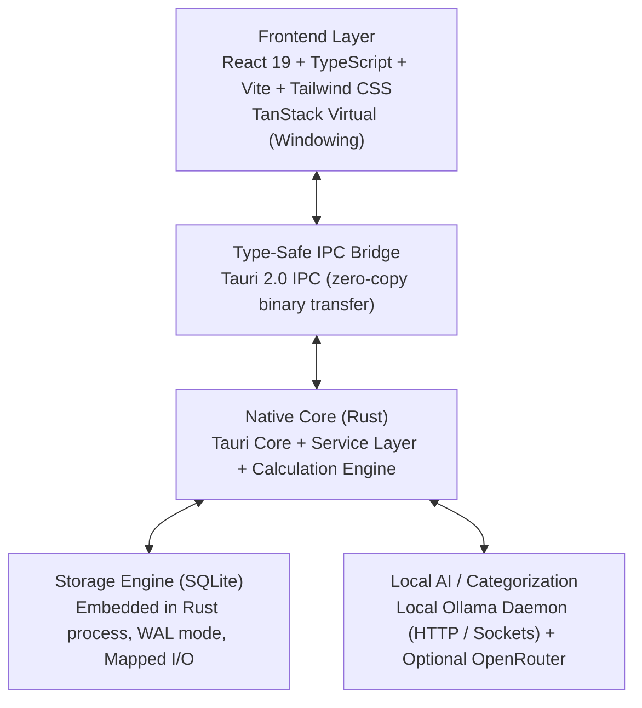

# metacent — Technology Stack Specification

## Core Requirements & Constraints

1. **Local-First & 100% Cross-Platform**: Native execution on Linux (primary development target: Linux Mint OS), Windows, and macOS with effortless compilation and packaging.
2. **Zero-Compromise Speed**: Must smoothly handle databases containing **millions of transactions** across 10+ years of historical data without UI lag or slow report generation.
3. **Privacy & Offline Independence**: No third-party bank connectors or forced cloud services. Complete local autonomy with local AI assistance via Ollama.

---

## Architectural Stack Overview

---

## Technology Choices

| Layer | Chosen Technology | Version / Tooling | Rationale & Trade-offs |
| :--- | :--- | :--- | :--- |
| **Desktop Shell** | **Tauri 2.0** | 2.x | Native Rust backend with native webview frontend. Memory footprint is ~40MB (vs. Electron's ~350MB). Native binary compilation for `.deb`/AppImage (Linux Mint), `.exe`/`.msi` (Windows), `.dmg` (macOS). |
| **Backend Core** | **Rust** | 1.80+ | Memory safety, zero-cost abstractions, multithreaded background parsing of multi-gigabyte CSV/OFX imports, blazing-fast mathematical calculations. |
| **Database Engine** | **SQLite** (via `rusqlite` / `sqlx`) | 3.46+ | Embedded directly in the Rust binary. Zero network hop. Configured with `PRAGMA journal_mode = WAL;`, `PRAGMA synchronous = NORMAL;`, `PRAGMA cache_size = -64000;` (64MB cache), and memory-mapped I/O (`mmap_size = 268435456`). Easily scans 10M rows in milliseconds. |
| **Frontend Framework**| **React 19 + TypeScript** | React 19, TS 5.6 | Proven ecosystem, strict type safety, wide library support for advanced financial tables, keyboard accessibility, and data visualization. |
| **Build & Tooling** | **Vite** | 5.x / 6.x | Instant Hot Module Replacement (HMR), lightweight build output, seamless integration with Tauri CLI. |
| **Styling** | **Tailwind CSS v4** | 4.x | Utility-first CSS configured with custom mint-green design tokens (`#ADEBB3`), dark/light mode, and tabular-num typography. |
| **Virtualization** | **TanStack Virtual** | v3 | Windowed DOM rendering: renders only the ~35 visible transaction rows out of 1,000,000 in memory. |
| **Data Visualization**| **Recharts / Observable Plot** | Latest | Minimalist, SVG/Canvas based charts for the 5 Reflect analytics tabs with mint-green colorways. |
| **Local AI Provider** | **Ollama** (Local SLM) | Local daemon | Connects to `http://localhost:11434` for small language model inference (`llama3.2:3b`, `qwen2.5:3b`, `phi3.5`). Fallback to OpenRouter API if cloud option enabled by user. |
| **Testing** | **Vitest + Cargo Test** | Latest | Unit testing in Rust for financial calculations and aggregations; Vitest for frontend UI and state tests; Playwright for end-to-end user flows. |

---

## Performance & Scalability Strategy for Millions of Transactions

Handling millions of transactions requires specific architectural decisions at every layer:

### 1. Integer Arithmetic in Rust
- All monetary amounts are handled as `i64` integers representing minor units (cents). Floating-point arithmetic is strictly prohibited in calculations to avoid precision drift.

### 2. Materialized Rollup Tables (CQRS / Incremental Deltas)
- Raw transactions are never scanned repeatedly to compute month budgets or KPI dashboards.
- A `monthly_category_rollups` table maintains precomputed sums (`assigned_cents`, `activity_cents`).
- SQLite triggers and Rust services maintain these rollups in $O(1)$ time upon transaction insert/update/delete.
- Planning views query only the ~50 category rows for the active month ($\sim 0.2\text{ms}$ query latency).

### 3. Asynchronous Streaming Importer
- Large CSV files (e.g. 500,000 rows) are processed in Rust worker threads using streaming chunks of 5,000 rows inside a single SQLite transaction with batch inserts.

### 4. DOM Virtualization
- TanStack Virtual ensures the browser DOM never contains more than 40 row nodes regardless of register size. Scrolling is 60fps even with 5,000,000 records.

---

## Compilation & Packaging Matrix

| Target OS | Build Artifact | Packaging Command |
| :--- | :--- | :--- |
| **Linux (Mint / Ubuntu / Debian)** | `.deb`, `AppImage` | `cargo tauri build --bundles deb,appimage` |
| **Windows** | `.msi`, `.exe` | `cargo tauri build --bundles msi,nsis` |
| **macOS** | Universal `.dmg`, `.app` | `cargo tauri build --bundles dmg` |
