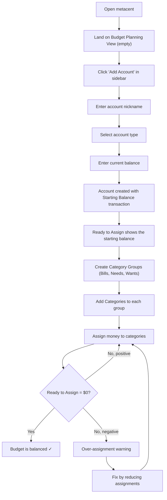
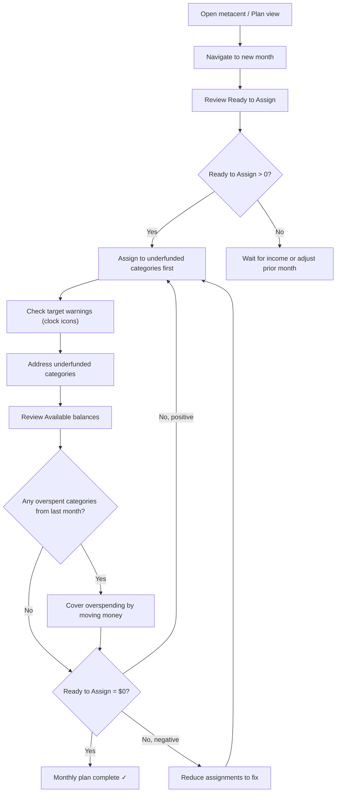
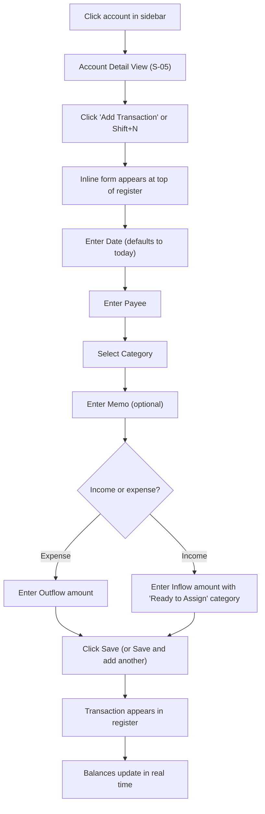
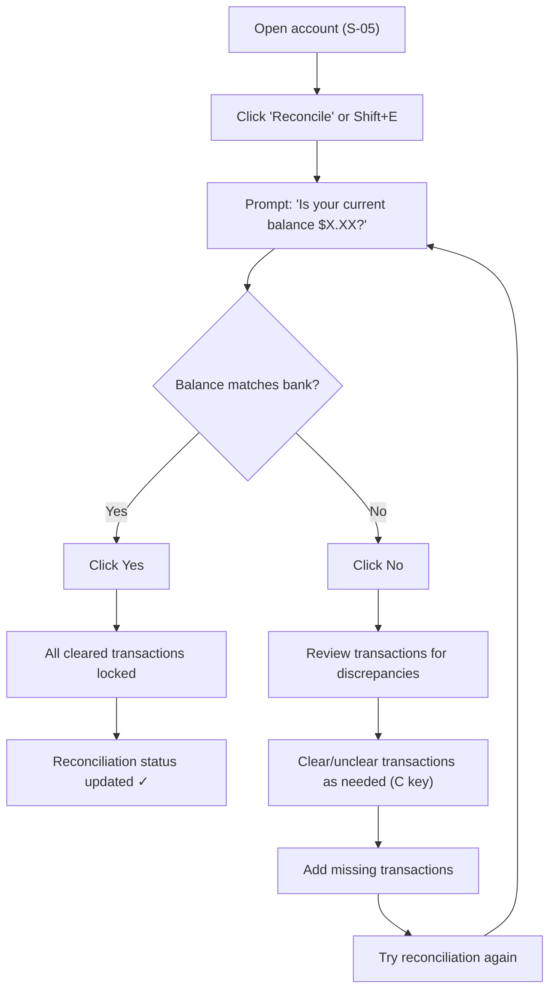
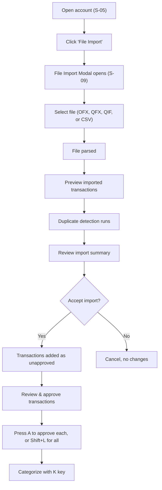
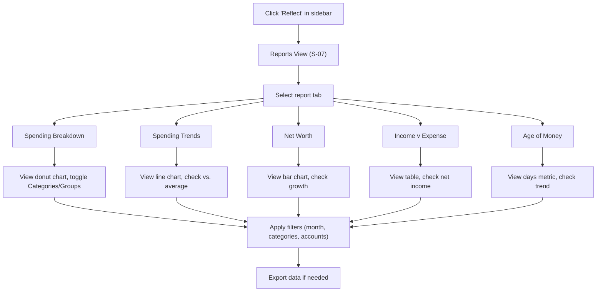
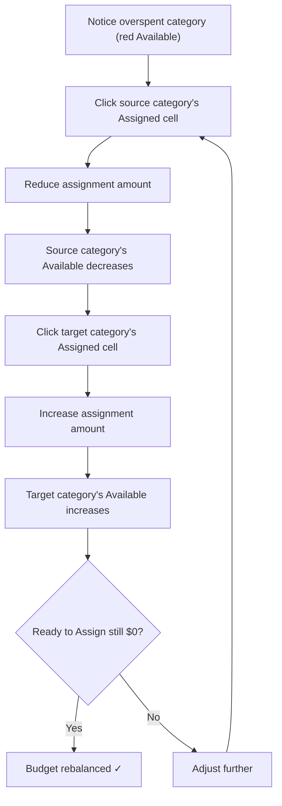

# User Flows

> Step-by-step walkthroughs of the main user journeys in metacent.

---

## Flow 1: First-Time Setup

**Goal:** A new user creates their first account and starts budgeting.

**Trigger:** User opens metacent for the first time.

### Steps

1. **Open metacent** → The app loads the Budget Planning View. It's empty — no accounts, no categories.

2. **Add first account**
   - Click "Add Account" in the sidebar
   - The Add Account Wizard (S-03) opens
   - Enter a nickname (e.g., "Main Checking")
   - Select type: Checking (under Cash Accounts)
   - Enter current balance (e.g., \$3,500.00)
   - Submit → Account appears in sidebar under "CASH" with balance

3. **Starting Balance created** → A transaction is automatically created in the account register: "Starting Balance" as "Inflow: Ready to Assign" for \$3,500.00.

4. **Ready to Assign updates** → The banner at the top of the planning view now shows "\$3,500.00 Ready to Assign".

5. **Create category structure**
   - Default Category Groups may be pre-created (Bills, Needs, Wants) or the user creates them with "+ Category Group"
   - Under each group, click "Add Category" to create categories:
     - Bills: 🏠 Rent/Mortgage, 📱 Phone & Internet, ⚡ Utilities, 🚗 Car Payment
     - Needs: 🛒 Groceries, ⛽ Gas, 💊 Medical
     - Wants: 🍽️ Dining Out, 🎬 Entertainment, 👕 Clothing

6. **Assign money** → Click each category's Assigned cell and enter an amount. Ready to Assign decreases with each assignment. The goal is to reach \$0.00.

7. **Set targets (optional)** → Click a category name to open the detail panel. Set a target (e.g., "I need \$1,200.00 by the 1st of each month" for Rent).

8. **Budget is balanced** → When Ready to Assign reaches \$0.00, every dollar has a job. The user's first budget is complete.

**Duration:** ~10 minutes for a motivated user.

---

## Flow 2: Monthly Planning Cycle

**Goal:** At the start of a new month, the user plans their budget.

**Trigger:** New month begins; user opens metacent.

### Steps

1. **Navigate to the new month** → Use the month selector to switch to the current month (e.g., "Nov 2026").

2. **Review Ready to Assign** → Check how much money is available to budget. This may include:
   - Leftover money from previous months
   - Income already received this month
   - Category rollover balances

3. **Check for overspending** → Look for categories with negative Available (red) from last month. These need to be covered — the overspending has already reduced Ready to Assign.

4. **Fund priority categories** → Start with obligations:
   - Look for categories with target warnings (clock icon, "more needed this month")
   - Assign money to Bills first, then Needs, then Wants
   - Click each Assigned cell and enter the amount

5. **Adjust as needed** → If Ready to Assign isn't enough:
   - Move money between categories (reduce a Want to fund a Need)
   - Decide which categories can wait

6. **Reach zero** → Continue assigning until Ready to Assign = \$0.00. Every dollar has a job for this month.

**Frequency:** Monthly (ideally within the first few days of the month, or when each paycheck arrives).

---

## Flow 3: Adding Transactions

**Goal:** Record a purchase or income in the register.

**Trigger:** User spent money or received income.

### Steps

1. **Open account** → Click the relevant account in the sidebar to open S-05.

2. **Start entry** → Click "Add Transaction" or press Shift+N. An inline form appears at the top of the register.

3. **Fill in fields** (Tab between them):
   - **Date** — Defaults to today. Use date picker shortcuts: T (today), arrows (navigate), +/− (day forward/back).
   - **Payee** — Type name; autocomplete suggests previously used payees.
   - **Category** — Select from dropdown. For income, choose "Inflow: Ready to Assign".
   - **Memo** — Optional note (e.g., "Weekly groceries").
   - **Outflow** — Amount spent (for expenses).
   - **Inflow** — Amount received (for income).

4. **Save** → Click "Save" to confirm. The transaction appears in the register. Or click "Save and add another" to immediately start a new entry.

5. **Balances update** → The account's Working Balance updates. The category's Activity and Available update. If it's income, Ready to Assign increases.

**Quick entry example (keyboard only):**
Shift+N → Tab → type "Trader Joe's" → Tab → type "Groceries" → Tab → Tab → type "85.50" → Enter

---

## Flow 4: Reconciliation

**Goal:** Verify that metacent's records match the bank statement.

**Trigger:** User receives a bank statement or wants to verify accuracy (recommended: weekly or at each statement).

### Steps

1. **Prepare** → Log into your bank and note the current cleared balance.

2. **Open the account** → Click the account in the sidebar.

3. **Start reconciliation** → Click "Reconcile" or press Shift+E.

4. **Check the balance** → The prompt shows: "Is your current balance \$X.XX?" Compare this to your bank statement.

5. **If it matches** → Click "Yes". All cleared transactions are locked (cannot be accidentally edited). The reconciliation status in the account header updates.

6. **If it doesn't match:**
   - Click "No" to return to the register
   - Compare transactions with your bank statement
   - Toggle cleared status (press C) for transactions that have been processed
   - Add any missing transactions
   - Try reconciling again

7. **Help available** → Click "How do I find my account balance?" for guidance on locating the right number from your bank.

---

## Flow 5: Importing Transactions from a File

**Goal:** Bulk import transactions from a bank export file.

**Trigger:** User downloads a transaction file from their bank.

### Steps

1. **Download from bank** → Export transactions from your bank's website. Prefer OFX or QFX format. QIF and CSV are also supported.

2. **Open the account** → Click the account in the sidebar.

3. **Start import** → Click "File Import" in the action bar. The File Import Modal (S-09) opens.

4. **Select the file** → Choose the downloaded file from your filesystem.

5. **Review preview** → The modal shows parsed transactions. Duplicate detection runs automatically:
   - Transactions you already entered manually will be matched
   - Direct Import duplicates (previously imported) are skipped
   - The summary shows counts: imported, matched, skipped

6. **Confirm import** → Imported transactions appear in the register as **unapproved**.

7. **Review and approve** → Go through each imported transaction:
   - Press A to approve individual transactions
   - Press Shift+L to approve all at once
   - Press K to assign a category
   - Press Shift+R to reject a suspicious transaction

---

## Flow 6: Reviewing Reports

**Goal:** Understand spending patterns, track net worth, and measure financial health.

**Trigger:** User wants to reflect on their financial situation (weekly, monthly, or ad hoc).

### Steps

1. **Navigate to Reflect** → Click "Reflect" in the sidebar to open the Reports View (S-07).

2. **Choose a report** by clicking the appropriate tab:

   **Spending Breakdown** — "Where did my money go?"
   - View the donut chart showing spending proportions
   - Toggle between Categories and Groups view
   - Check the sidebar list for exact amounts
   - Filter by specific month, categories, or accounts

   **Spending Trends** — "Am I spending more or less over time?"
   - View the line chart for spending trajectory
   - Check Average Monthly Spending for a baseline
   - Review the month-over-month table, noting the "Compared to Average" column
   - Identify months that are significantly above or below average

   **Net Worth** — "Am I building wealth?"
   - View the bar chart: blue (assets) vs. red (debts)
   - Check the Net Worth total and change (amount + %)
   - Review the monthly table for trends
   - Use "Share Your Progress" to celebrate milestones

   **Income v Expense** — "Am I living within my means?"
   - Review the income section: all sources and total
   - Review the expense section: total
   - Check Net Income (positive = saving, negative = spending more than earning)
   - Compare across months using the Average and Total columns

   **Age of Money** — "Am I breaking the paycheck-to-paycheck cycle?"
   - Check the current Age of Money in days
   - A higher number means you're spending older dollars (good)
   - If below 10 transactions, the metric isn't available yet
   - Goal: Age of Money > 30 days

3. **Apply filters** → Use category and account filters to focus on specific areas.

4. **Navigate time** → Use prev/next month controls to view different periods.

5. **Export** → Click the export button to download report data for external use.

---

## Flow 7: Moving Money Between Categories

**Goal:** Adjust the budget mid-month when plans change.

**Trigger:** Unexpected expense, change in priorities, or overspending in a category.

### Steps

1. **Identify the problem** → A category shows a negative Available (red) — you've overspent. Or, a new expense has come up that doesn't fit the current plan.

2. **Find a source** → Look for a category with excess Available that you can afford to reduce this month (often a "Want" category).

3. **Reduce the source** → Click the source category's Assigned cell. Reduce the amount. The Available decreases, but Ready to Assign increases by the same amount.

4. **Fund the target** → Click the overspent or underfunded category's Assigned cell. Increase the amount. Ready to Assign decreases back to zero.

5. **Verify** → Ready to Assign should still be \$0.00. The overspent category should now be funded (Available ≥ 0).

**Key insight:** This is "rolling with the punches" — the budget adapts to reality without guilt. The important thing is that every dollar still has a job.
